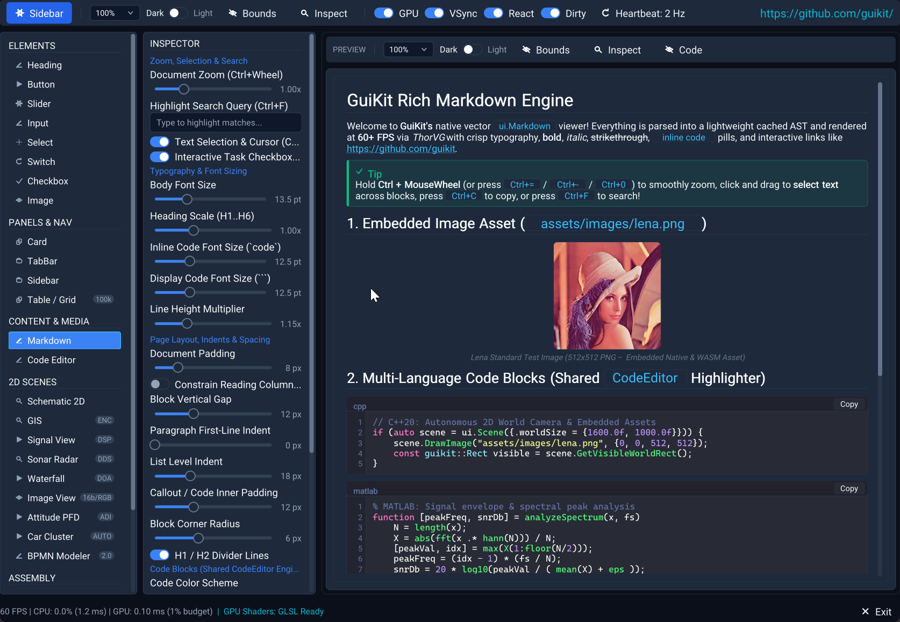
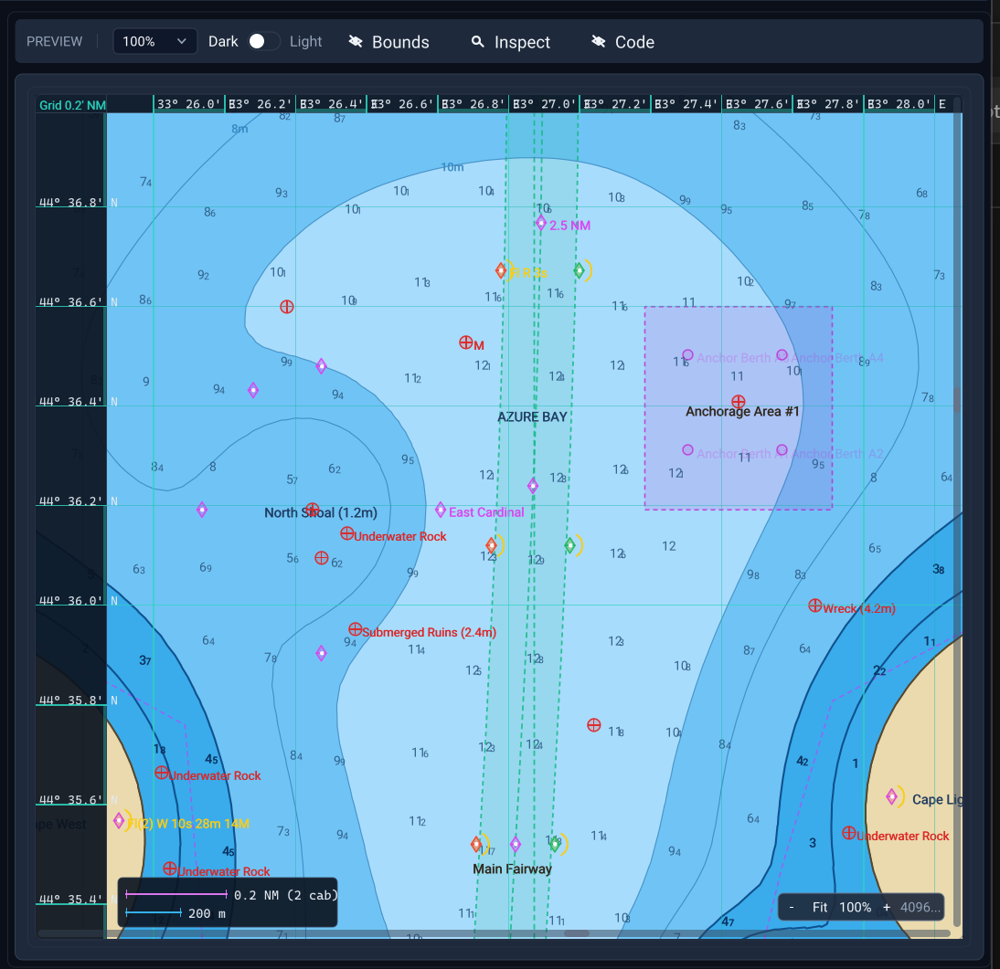
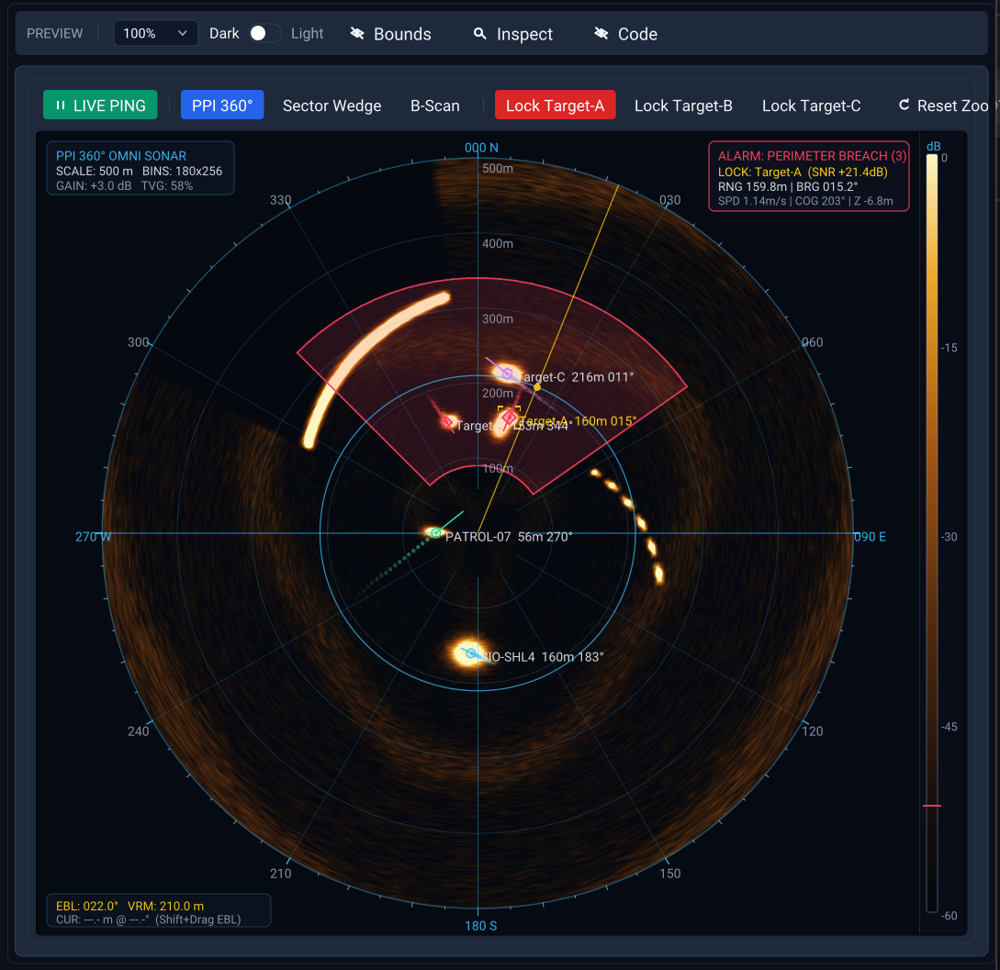
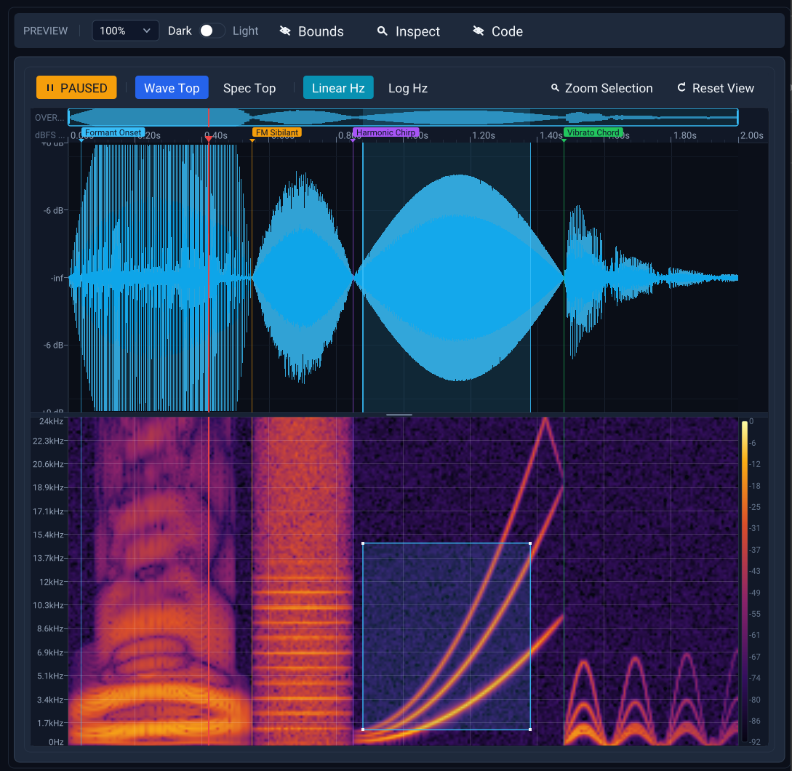
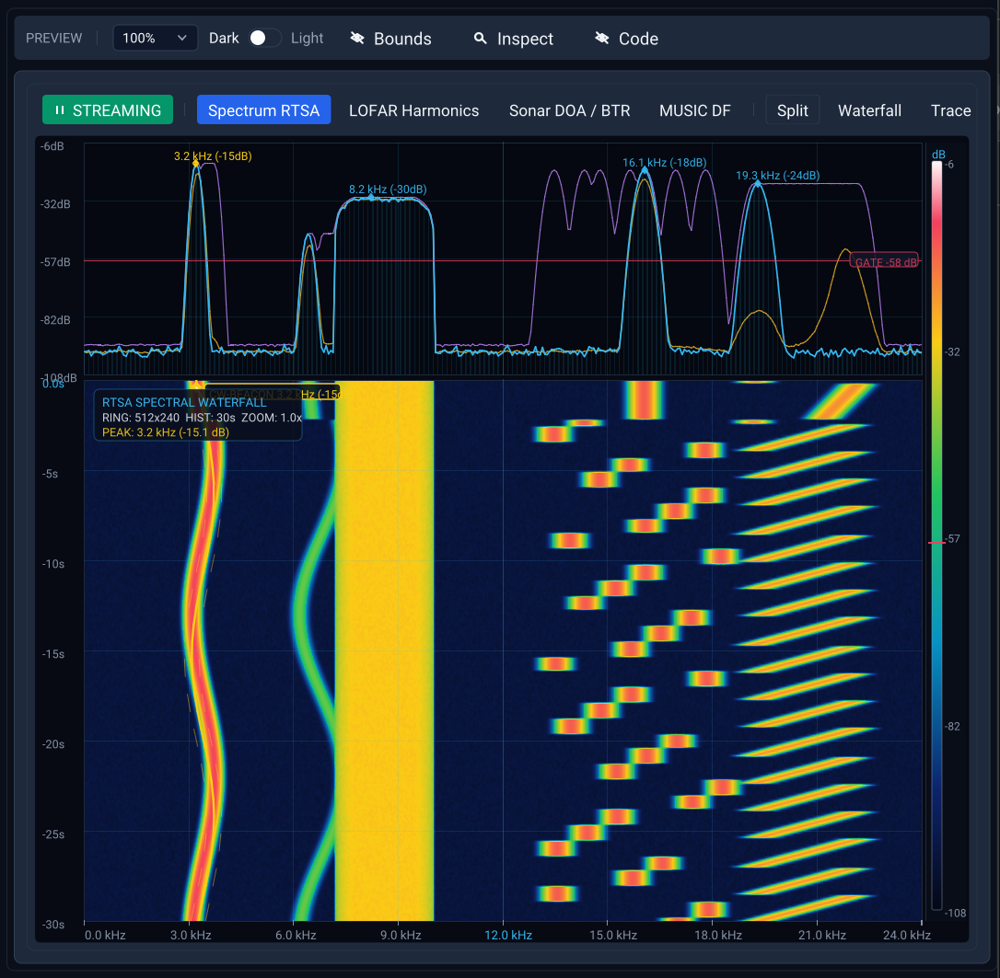
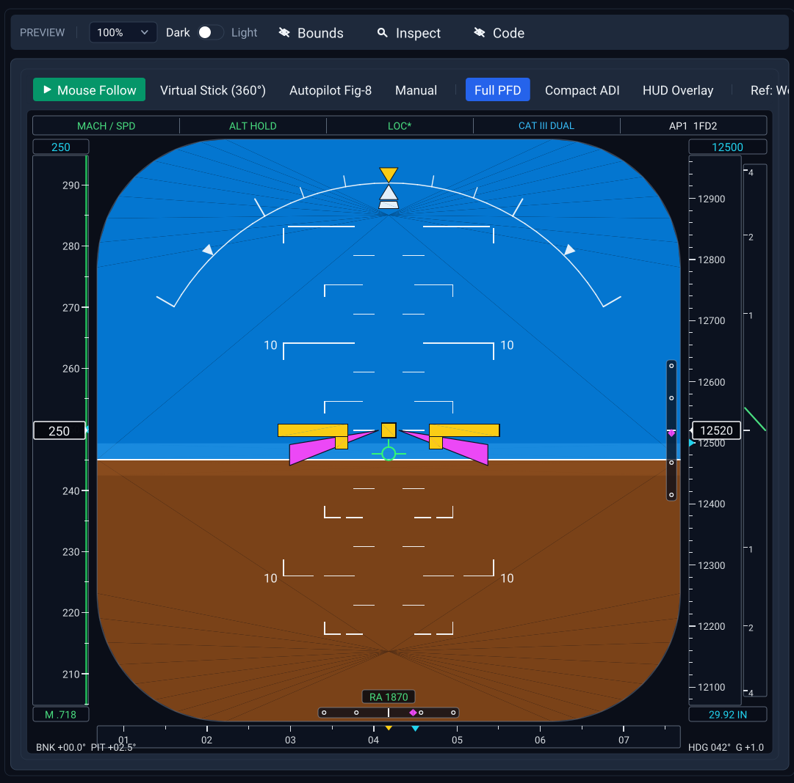
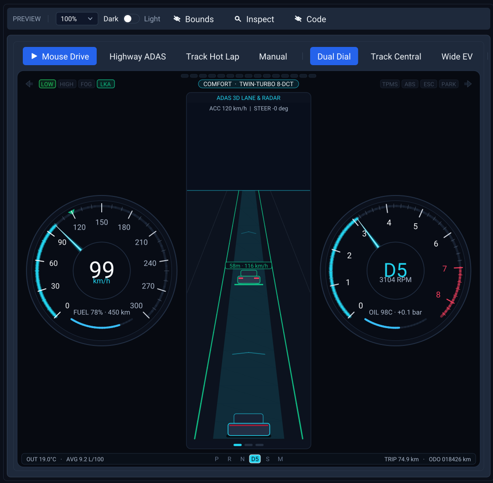
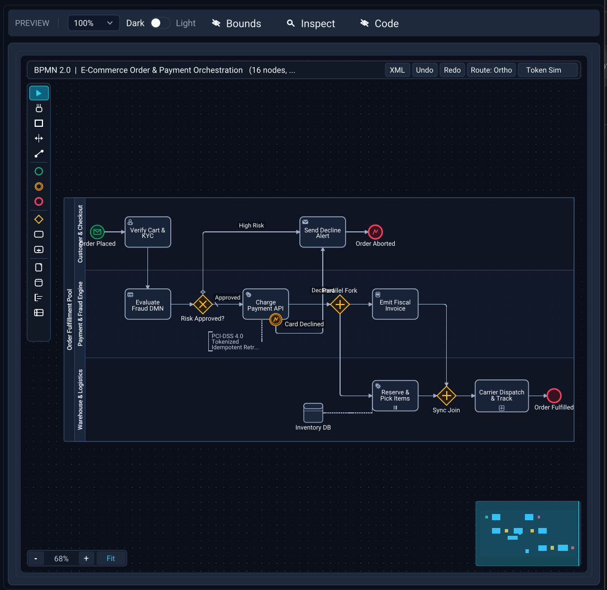

# GuiKit

**GuiKit** is a modern, autonomous C++20 immediate-mode vector GUI and 2D visualization engine powered by **ThorVG**, **SDL3**, and **WebGL2 / OpenGL GLSL** for both Native Desktop and WebAssembly.

## 👉 [Live Interactive Demo (WebAssembly): https://guikit.github.io/demo/](https://guikit.github.io/demo/)

| **Workspace & Rich Markdown Engine** | **S-52 / ENC Marine GIS Vector Chart** |
| :---: | :---: |
|  |  |
| **PPI 360° Sonar Radar (`SonarView`)** | **Waveform + STFT Spectrogram (`SignalView`)** |
|  |  |
| **RTSA Spectral Waterfall (`WaterfallView`)** | **Avionics Primary Flight Display (`AttitudeView`)** |
|  |  |
| **Automotive Cockpit & ADAS (`CarClusterView`)** | **BPMN 2.0 Modeler & Token Sim (`BpmnEditor`)** |
|  |  |

---

## Key Highlights

- **Pure Vector Rendering & GLSL Underlays**: Razor-sharp UI at any DPI and scale via **ThorVG**, combined with hardware-accelerated **OpenGL / WebGL2 GLSL** shader underlays (`SdlGlShaderEngine`) for real-time DSP, sonar, and waterfall displays.
- **100% Autonomous C++20 Immediate Mode**: Zero dependency on Dear ImGui. Clean, composable `Element` + `Control` architecture using designated initializers, RAII container scopes, `ui.Size(...)` scoping, and reactive dirty-rectangle damage tracking:
  ```cpp
  if (auto card = ui.Card({
      .gap = 12.0f,
      .padding = guikit::Padding::All(16.0f),
      .border = {.width = 1.0f, .radius = 8.0f}
  })) {
      ui.Size(guikit::UiSize::Md).Heading({
          .label = "Mission Control",
          .description = "Closed-loop attitude & thruster telemetry",
          .icon = guikit::Icon::Play(),
          .divider = true
      });
      if (auto el = ui.Element({.label = "Main Thruster Output"})) {
          ui.Slider(thrustPct, 0.0f, 100.0f, {.valueFormat = "%.1f %%"});
      }
      if (ui.Button({
          .text = "Engage Autopilot",
          .icon = guikit::Icon::Flash(),
          .color = guikit::StateColor::Primary()
      })) {
          EngageAutopilot();
      }
  }
  ```
- **Zero-File Embedded Assets (Native + WebAssembly)**: Automatic build-time asset embedding (`guikit::Assets`) compiles fonts, images, and GeoJSON charts directly into the binary so both Native `.exe` and `.wasm` builds run as self-contained bundles.
- **Reactive Event Loop & Dirty Rect Tracking**: Sleeps at 0% CPU when idle and repaints only damaged screen regions at sub-millisecond frame times.

---

## Component & Scene Suite

### 1. Core Elements & Inputs (`guikit::core`)
- **Structure & Display**: `Element` (universal label / description / icon / badge / frame wrapper for any control), `Heading` (H1–H4 titles, subtitles, bottom & trailing dividers), `Text` (semantic roles & variants), `Image` (PNG/JPG/SVG with `ImageFit` & rounding), procedural vector `Icon` library
- **Buttons & Toggles**: `Button`, `Switch`, `Checkbox`, `Radio`, `Segmented` (single-select & multi-select bitmask `SegmentedMask`)
- **Numeric, Metering & Steppers**: `Slider`, `RangeSlider`, `StepSlider`, `ProgressBar` (smooth, discrete LED segments & indeterminate), `LevelMeter` (single/multi-channel dB VU meter with 3-zone coloring, auto peak-hold & clip LED), `Knob` (rotary dial with bipolar mode, radial ticks & arc), `SpinBox` (inline, detached & split steppers with drag-to-scrub)
- **Text, Tags & Selection**: `InputField` (text, password & numeric with validation), `TagInput` (editable multi-tag chips with delimiter splitting & backspace-pop), `Select`, `ComboBox`, `Autocomplete`, `MultiSelect` (multi-chip tag trigger + checkbox dropdown)
- **Pickers**: `ColorPicker` (interactive 2D HSV canvas, hue/alpha sliders, HEX input & preset swatches), `DatePicker` (`Date`, `DateTime`, and `Time` modes with calendar popover & time steppers)

### 2. Layouts, Panels, Navigation & Overlays (`guikit::core`)
- **Layout Solver**: `Row`, `Column`, `Wrap`, `Grid` (12-column responsive layout), `Spacer`
- **Panels & Containers**: `Box`, `Card`, `SplitView` (horizontal, vertical & nested resizable panes with double-click reset & collapse), `Accordion` (collapsible sections), `ScrollArea`, `Sidebar`, `ActivityBar`, `BottomPanel`, `StatusBar`, `Carousel`
- **Navigation**: `TabBar` (with automatic carousel overflow & closable tabs), `Breadcrumb` (chevron/slash/arrow/dot separators & interactive `...` overflow collapse), `Pagination` (smart ellipsis windowing & keyboard navigation), `Toolbar`, `SidebarMenu`
- **Hierarchical & Virtualized Data**: `TreeView` (expandable nodes, guide lines, search filter & multi-column cells), `Table` (virtualized data grid with 60+ FPS scrolling, sorting, filtering & row selection over **100,000+ rows**)
- **Overlays & Notifications**: `Modal` (dialog with backdrop), `Popover` (anchored floating card), `ContextMenu` (right-click menu with shortcuts & check items), `CommandPalette` (`Ctrl+K` fuzzy command launcher with substring highlighting), `Toast` (non-blocking corner notifications with progress bars)
- **Rich Content**: `Markdown` viewer (GFM tables, alerts, task lists, code blocks, embedded assets) & `TextArea` / `CodeEditor` (syntax highlighting, breakpoints, code folding, minimap & find/replace bar)

### 3. Specialized 2D Scenes & Domain Workstations (`guikit::scenes`)
- **Schematic 2D (`Scene`)**: Infinite pan/zoom vector viewport with grid/checkerboard backgrounds and coordinate rulers
- **GIS / Marine Chart (`MapView` + `GisRenderEngine`)**: S-57 / ENC vector Electronic Navigational Chart (`.geojson`) with S-52 Day/Dusk/Night palettes, safety contour isobaths, spot soundings, IALA seamarks, 256×256 vector tile caching, and 7 geodetic projections (`EPSG:3857`, `EPSG:3395`, `EPSG:4326`, `UTM 36N`, `GSK-2011`, `SK-42`, `Arctic Polar`)
- **Signal View (`SignalView`)**: Dual waveform + STFT spectrogram analyzer with GPU shader acceleration and harmonic cursor readouts
- **Sonar Radar (`SonarView`)**: Polar PPI 360°, Sector Wedge, and B-Scan sonar/radar display with TVG, clutter gating, and target tracking
- **Waterfall (`WaterfallView`)**: Hardware circular ring-buffer RTSA spectrum waterfall & DOA target tracker
- **Image View (`ImageView` + `Histogram`)**: 16-bit scientific & multi-channel RGB workstation with interactive Window/Level transfer functions and pixel-value loupe
- **Attitude PFD (`AttitudeView`)**: Avionics Primary Flight Display with artificial horizon, pitch ladder, airspeed/altitude tapes, and compass rose
- **Car Cluster (`CarClusterView`)**: Digital automotive instrument cluster & ADAS cockpit
- **BPMN 2.0 Modeler (`BpmnEditor`)**: Full interactive BPMN 2.0 diagram editor (`bpmn-js` parity) with context pad, palette, orthogonal Manhattan waypoint routing, swimlanes, and live token simulation

---

## Directory Structure

```text
guikit/
├── include/guikit/      # Public C++20 headers
│   ├── backend/         # Canvas & GPU shader abstractions (ThorCanvas, SdlCanvas, SdlGlShaderEngine)
│   ├── core/            # Tokens, Theme, Types, Control, Element, Assets, Allocator, Id, FrameMetrics
│   ├── geo/             # Geodesy projections (MapGrid), GeoJSON parser, S-52 GIS render engine
│   ├── graphics/        # Procedural vector Icons & Colormaps
│   ├── layout/          # Flexbox & 12-column Grid solver (Row, Column, Wrap, Grid, Spacer)
│   ├── panels/          # Containers, splitters, overlays & viewports (Box, Card, SplitView, Table...)
│   ├── widgets/         # Autonomous immediate-mode widgets & domain instruments
│   ├── Context.hpp      # Primary immediate-mode UI Context
│   ├── Core.hpp         # Lightweight core + widgets header
│   ├── Scenes.hpp       # Domain scenes & GIS header
│   └── GuiKit.hpp       # Master umbrella include & version macros
├── src/guikit/          # Implementation units (.cpp)
├── examples/
│   ├── minimal/         # Single-file ~100-line quickstart application (examples/minimal/main.cpp)
│   └── demo/            # Full interactive showcase & C++20 code generator (Desktop + WebAssembly)
├── assets/              # Embedded fonts, images (lena.png), and GIS chart (demo_bay.geojson)
├── scripts/             # Build, local server, and GitHub Pages deployment scripts
├── tests/               # Automated unit test suites (test_core, test_layout, test_context)
└── third_party/         # SDL3 and ThorVG submodules
```

---

## Quick Start & Building

### Prerequisites
- C++20 compiler (MSVC 2022+, Clang 15+, GCC 12+, or Emscripten for WebAssembly)
- CMake 3.21+
- Git

### 1. Clone with Submodules
```bash
git clone --recursive https://github.com/guikit/guikit.git
cd guikit
```

### 2. Desktop Build & Run (Windows)
```cmd
:: Configure & build Release
scripts\windows\desktop-build.cmd

:: Build & launch the interactive demo
scripts\windows\desktop-run.cmd
```

Or via standard CMake:
```cmd
cmake -B build -S .
cmake --build build --config Release
ctest --test-dir build -C Release --output-on-failure
```

### 3. WebAssembly Build, Local Run & GitHub Pages Deploy
```cmd
:: Build WebAssembly bundle (auto-installs local .emsdk if needed)
scripts\windows\web-build.cmd

:: Build, start local HTTP server, and open in browser
scripts\windows\web-run.cmd

:: Build and publish to GitHub Pages (https://guikit.github.io/demo/)
scripts\windows\web-publish.cmd
```

---

## Integrating GuiKit into Your CMake Project

Add GuiKit via `add_subdirectory` or `FetchContent` and link against `guikit::guikit` (umbrella target) or `guikit::core` (zero-dependency pure C++20 UI core):

```cmake
include(FetchContent)
FetchContent_Declare(
    guikit
    GIT_REPOSITORY https://github.com/guikit/guikit.git
    GIT_TAG        main
    GIT_SHALLOW    TRUE
)
FetchContent_MakeAvailable(guikit)

add_executable(my_app main.cpp)
target_link_libraries(my_app PRIVATE guikit::guikit)
```

See [`examples/minimal/main.cpp`](examples/minimal/main.cpp) for a complete single-file starter template.

---

## License

MIT License. See [LICENSE](LICENSE) for details.
