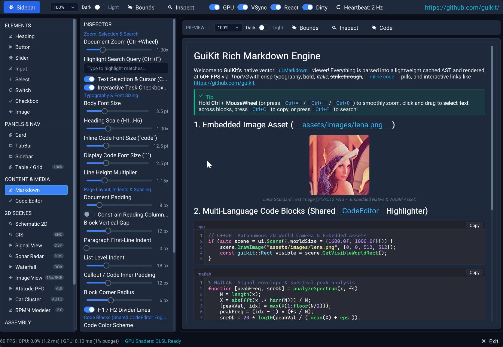

# GuiKit

**GuiKit** is a modern, autonomous C++20 immediate-mode vector GUI and 2D visualization library powered by **ThorVG**, **SDL3**, and **WebGL2 / OpenGL GLSL** for both Native Desktop and WebAssembly.

## 👉 [Live Interactive Demo (WebAssembly): https://guikit.github.io/demo/](https://guikit.github.io/demo/)



> Looking for the full interactive showcase (`guikit_demo`) combining all widgets and domain modules (GIS, Signal/Radar, Cockpit, BPMN)? See **[`guikit/bundle`](https://github.com/guikit/bundle)**.

---

## Key Highlights

- **Pure Vector Rendering & GLSL Underlays**: Razor-sharp UI at any DPI and scale via **ThorVG**, combined with hardware-accelerated **OpenGL / WebGL2 GLSL** shader underlays (`SdlGlShaderEngine`) for real-time 2D visualizations.
- **100% Autonomous C++20 Immediate Mode**: Zero dependency on Dear ImGui and zero STL headers in public headers (powered by [`keel`](https://github.com/guikit/keel)). Clean, composable `Element` + `Control` architecture using designated initializers, RAII container scopes, `ui.Zone(...)` ambient scoping, and reactive dirty-rectangle damage tracking:
  ```cpp
  if (auto card = ui.Card({
      .gap = 12.0f,
      .padding = guikit::Padding::All(16.0f),
      .border = {.width = 1.0f, .radius = 8.0f}
  })) {
      ui.Heading({
          .label = "Mission Control",
          .description = "Closed-loop attitude & thruster telemetry",
          .icon = guikit::Icon::Play(),
          .separator = guikit::HeadingSeparator::Bottom
      });
      if (auto el = ui.Element({.label = "Main Thruster Output"})) {
          ui.Slider(thrustPct, 0.0f, 100.0f, {.valueFormat = "%.1f %%"});
      }
      if (ui.Button({
          .text = "Engage Autopilot",
          .icon = guikit::Icon::Flash(),
          .color = guikit::StateColor::Primary()
      })) {
          EngageAutopilot();
      }
  }
  ```
- **Zero-File Embedded Assets (Native + WebAssembly)**: Automatic build-time asset embedding (`guikit::Assets`) compiles fonts and icons directly into the binary so both Native and `.wasm` builds run as self-contained bundles.
- **Reactive Event Loop & Dirty Rect Tracking**: Sleeps at 0% CPU when idle and repaints only damaged screen regions at sub-millisecond frame times.

---

## Component Suite

### 1. Core Elements & Inputs
- **Structure & Display**: `Element` (universal label / description / icon / badge form-field wrapper), `Heading` (`H1`–`H6` titles, subtitles, bottom & trailing separators), `Text` (semantic roles, variants & inline Markdown via `UiText::Rich`), `Image` (PNG/JPG/SVG with `ObjectFit` & corner rounding), procedural vector `Icon` library
- **Buttons & Selection**: `Button`, `Switch`, `Checkbox` (with indeterminate state), `Radio`, `Segmented` (single-select & multi-select bitmask `SegmentedMask`)
- **Numeric, Metering & Steppers**: `Slider`, `RangeSlider`, `StepSlider` (horizontal or vertical), `ProgressBar` (smooth, discrete LED segments & indeterminate), `LevelMeter` (single/multi-channel dB VU meter with 3-zone coloring, peak-hold & clip LED), `Knob` (rotary dial with bipolar mode, radial ticks & arc), `SpinBox` (integer & float numeric steppers)
- **Text, Tags & Selection**: `InputField` (text, password & filtered numeric input), `TagInput`, `Select`, `ComboBox`, `Autocomplete`, `MultiSelect`
- **Pickers**: `ColorPicker` (2D HSV canvas, hue/alpha sliders, HEX input & swatches), `DatePicker` (`Date`, `DateTime`, and `Time` modes)

### 2. Layouts, Panels, Navigation & Overlays
- **Layout Solver**: `Row`, `Column`, `Wrap`, `Grid` (12-column responsive layout), `Spacer`, `Gap`, `Zone` (ambient theme, scale & density)
- **Panels & Containers**: `Box`, `Card`, `SplitView`, `Accordion`, `ScrollArea`, `Sidebar`, `ActivityBar`, `BottomPanel`, `StatusBar`, `Carousel`
- **Navigation**: `TabBar`, `Breadcrumb`, `Pagination`, `Toolbar`, `SidebarMenu`
- **Hierarchical & Virtualized Data**: `TreeView` (multi-column, filterable hierarchy), `Table` (virtualized data grid supporting **100,000+ rows**)
- **Overlays & Notifications**: `Modal` (stacked dialog portals with focus trap), `Popover`, `ContextMenu`, `CommandPalette` (`Ctrl+K` fuzzy launcher), `Toast`
- **Rich Content & 2D Canvas**: `Markdown` viewer (GFM tables, alerts, task lists, code blocks, images), `TextArea` / `CodeEditor` (syntax highlighting, breakpoints, code folding, minimap, find/replace), `Scene` (infinite pan/zoom vector canvas with grid, rulers & draggable items), `ImageView` + `Histogram` (16-bit scientific & RGB image viewer)

---

## GuiKit Ecosystem

Domain-specific visualization and workstation modules live in dedicated companion repositories:

| Repository | CMake Target | Components |
| :--- | :--- | :--- |
| **[`guikit/bundle`](https://github.com/guikit/bundle)** | `guikit::all` | Unified workspace combining all modules + full interactive `guikit_demo` (Desktop & WebAssembly) |
| **[`guikit/geo`](https://github.com/guikit/geo)** | `guikit::geo` | Multi-CRS geodesy, GeoJSON I/O, S-52/ENC marine vector GIS engine, OSM tiles & `MapView` |
| **[`guikit/signal`](https://github.com/guikit/signal)** | `guikit::signal` | DSP Waveform + STFT Spectrogram (`SignalView`), Polar Sonar/Radar (`SonarView`), RTSA Waterfall (`WaterfallView`) |
| **[`guikit/cockpit`](https://github.com/guikit/cockpit)** | `guikit::cockpit` | Avionics Primary Flight Display (`AttitudeView`) & Automotive Instrument Cluster (`CarClusterView`) |
| **[`guikit/diagram`](https://github.com/guikit/diagram)** | `guikit::diagram` | Interactive BPMN 2.0 Modeler & Token Simulator (`BpmnEditor`) |

---

## Directory Structure

```text
guikit/
├── include/guikit/      # Public C++20 headers (zero-STL pure)
│   ├── backend/         # Canvas & GPU shader abstractions (ThorCanvas, SdlCanvas, SdlGlShaderEngine)
│   ├── core/            # Tokens, Theme, Types, Control, Element, Assets, Allocator, Id, FrameMetrics
│   ├── graphics/        # Procedural vector Icons & Colormaps
│   ├── layout/          # Flexbox & 12-column Grid solver (Row, Column, Wrap, Grid, Spacer)
│   ├── panels/          # Containers, splitters, overlays & viewports (Box, Card, SplitView, Table, Scene...)
│   ├── widgets/         # Autonomous immediate-mode widgets
│   ├── context.hpp      # Primary immediate-mode UI Context
│   ├── core.hpp         # Lightweight core + widgets header
│   └── guikit.hpp       # Master umbrella include & version macros
├── src/guikit/          # Implementation units (.cpp)
├── examples/
│   └── minimal/         # Single-file quickstart application (guikit_minimal)
├── assets/              # Embedded fonts and application icon
├── cmake/               # Asset embedding & guideline enforcement CMake helpers
├── scripts/             # Dependency install & desktop build scripts
├── tests/               # Automated unit tests (test_core, test_layout, test_context, header purity)
└── third_party/         # keel, SDL3, and ThorVG submodules
```

---

## Quick Start & Building

### Prerequisites
- C++20 compiler (MSVC 2022+, Clang 15+, GCC 12+, or Emscripten for WebAssembly)
- CMake 3.21+
- Git
- **Linux (Ubuntu / Debian / Fedora / Arch)** — X11, Wayland, and OpenGL development headers required when building the `SDL3` desktop backend:
  ```bash
  ./scripts/linux/install-deps.sh
  ```

### Clone & Build Standalone
```bash
git clone --recursive https://github.com/guikit/guikit.git
cd guikit
cmake -S . -B build
cmake --build build --config Release --parallel
ctest --test-dir build -C Release --output-on-failure
./build/guikit_minimal
```

For the full 38-screen interactive showcase (`guikit_demo`) and WebAssembly build/publish pipeline, clone [`guikit/bundle`](https://github.com/guikit/bundle).

---

## Integrating GuiKit into Your CMake Project

Add GuiKit via `add_subdirectory` or `FetchContent` and link against `guikit::guikit` (full desktop/WASM target) or `guikit::core` (headless pure C++20 UI core):

```cmake
include(FetchContent)
FetchContent_Declare(
    guikit
    GIT_REPOSITORY https://github.com/guikit/guikit.git
    GIT_TAG        main
    GIT_SHALLOW    TRUE
)
FetchContent_MakeAvailable(guikit)

add_executable(my_app main.cpp)
target_link_libraries(my_app PRIVATE guikit::guikit)
```

See [`examples/minimal/main.cpp`](examples/minimal/main.cpp) for a complete single-file starter template, and [`AGENTS.md`](AGENTS.md) for the complete architecture, component selection, and best-practices guide for developers and AI coding agents.

---

## License

BSD Zero Clause License (`0BSD`). See [LICENSE](LICENSE) for details.
